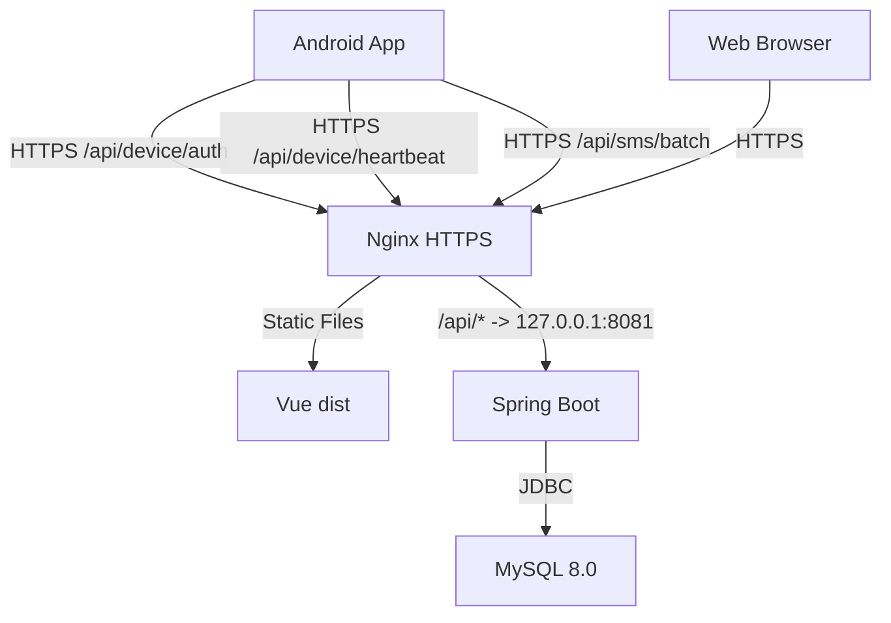

# SyncSMS 项目构建与部署存档

> 本文用于长期存档 SyncSMS 的设计、构建、部署、运行与维护信息。文档中不记录真实密码、真实生产密钥或私人域名；部署时请使用自己的域名与环境变量替换占位内容。

## 1. 项目目标

SyncSMS 是一个短信同步与查看系统，主要面向“收验证码专用手机”场景：

- Android 手机负责接收短信、上报电量/在线状态、上传短信内容。
- 后端负责设备认证、短信入库、用户登录、安全风控、审计与管理接口。
- 前端负责展示设备状态、短信列表、短信详情、已读状态与后台管理。

## 2. 仓库地址

- GitHub：`https://github.com/Henry-Fox/SyncSMS.git`
- Gitee：`https://gitee.com/meng-hengli66/sync-sms.git`

## 3. 目录结构

```text
SyncSMS/
├── android/   # Android 客户端
├── backend/   # Spring Boot 后端
├── frontend/  # Vue 前端
├── docs/      # 项目文档
├── sql/       # 初始化 SQL / 历史脚本
└── README.md
```

## 4. 总体架构



### 关键约定

- Web 入口：`https://example.com/`
- API 入口：`https://example.com/api/*`
- 后端本机端口：`127.0.0.1:8081`
- Android App 中的 `server` 应填写域名根地址：
  - 正确：`https://example.com`
  - 错误：`https://example.com/api`

## 5. 技术栈

详细版本以 `docs/tech-stack-with-versions.md` 为准。核心技术：

- 前端：Vue 3、Vite、Element Plus、Pinia、Axios、MockJS
- 后端：Java 17、Spring Boot 3.5.12、Spring Security、JWT、MyBatis-Plus、Flyway
- 数据库：MySQL 8.0
- Android：Kotlin、Foreground Service、WorkManager、Room、NotificationListenerService
- 部署：宝塔、Nginx、HTTPS、Java 项目管理器

## 6. 后端构建

### 前置环境

- Java 17
- Maven 3.9+
- MySQL 8.0

### 关键配置

后端配置文件：`backend/src/main/resources/application.yml`

推荐通过环境变量注入敏感配置：

```text
SPRING_DATASOURCE_URL=jdbc:mysql://127.0.0.1:3306/syncsms?useUnicode=true&characterEncoding=utf-8&serverTimezone=Asia/Shanghai
SPRING_DATASOURCE_USERNAME=syncsms
SPRING_DATASOURCE_PASSWORD=<your-db-password>
SYNCSMS_JWT_SECRET=<long-random-secret>
```

### 本地启动

```bash
cd backend
mvn spring-boot:run
```

### 打包

```bash
cd backend
mvn -DskipTests package
```

产物：

```text
backend/target/syncsms-backend-1.0.0.jar
```

## 7. 前端构建

### 前置环境

- Node.js 18 LTS 或 20 LTS
- npm

### 本地启动

```bash
cd frontend
npm ci
npm run dev
```

### 生产打包

```bash
cd frontend
npm ci
npm run build
```

产物：

```text
frontend/dist/
```

Windows 上如果遇到 `EPERM: unlink esbuild.exe`，通常是 `node.exe` 或杀毒软件占用文件。处理方式：

```powershell
taskkill /F /IM node.exe
taskkill /F /IM esbuild.exe
Remove-Item -Recurse -Force .\node_modules
npm cache clean --force
npm ci
```

## 8. Android 构建与使用

### 构建

```bash
cd android
.\gradlew.bat :app:assembleDebug
```

安装到已连接设备：

```bash
cd android
.\gradlew.bat :app:installDebug
```

### 运行配置

App 内需要填写：

- 服务器地址：`https://example.com`
- 设备密钥：Web 后台新增设备后生成的 `deviceKey`

### 必要权限

- 短信权限：用于标准 `content://sms` 轮询。
- 通知监听权限：用于捕获华为/荣耀等 ROM 上无法从标准短信数据库读取的验证码通知。
- 通知权限：用于前台服务常驻通知。
- 电池/后台权限：建议关闭自动管理，允许自启动、关联启动、后台活动。

### 短信获取策略

Android 端采用两条链路：

- `content://sms` 轮询：适用于系统开放标准短信内容提供者的短信。
- `NotificationListenerService`：用于捕获新收到的短信通知，尤其适合华为/荣耀上的验证码短信。

注意：通知监听只能捕获“新通知”，不能读取历史通知。历史短信如需一次性导入，可在调试设备通过 ADB shell 导出标准短信库后上传。

## 9. 宝塔生产部署

### 服务器组件

- Nginx
- MySQL 8.0
- JDK 17
- 宝塔 Java 项目管理器
- Let's Encrypt HTTPS 证书

### 数据库

创建数据库：

```text
数据库名：syncsms
用户名：syncsms
密码：使用强密码
```

### 后端部署

上传 jar 到服务器，例如：

```text
/www/wwwroot/backend/syncsms-backend-1.0.0.jar
```

宝塔 Java 项目管理器配置：

- 项目类型：Spring Boot
- JDK：17
- 端口：8081
- 启动命令示例：

```bash
/www/server/java/jdk-17.0.8/bin/java -Xmx1024M -Xms256M -jar /www/wwwroot/backend/syncsms-backend-1.0.0.jar --server.port=8081
```

环境变量：

```text
SPRING_DATASOURCE_URL=jdbc:mysql://127.0.0.1:3306/syncsms?useUnicode=true&characterEncoding=utf-8&serverTimezone=Asia/Shanghai
SPRING_DATASOURCE_USERNAME=syncsms
SPRING_DATASOURCE_PASSWORD=<your-db-password>
SYNCSMS_JWT_SECRET=<long-random-secret>
```

### 前端部署

将 `frontend/dist/` 下所有内容上传到站点根目录，例如：

```text
/www/wwwroot/example.com/
```

### Nginx 配置

站点配置中需要同时支持前端路由和 `/api` 反代：

```nginx
location /api/ {
  proxy_pass http://127.0.0.1:8081;
  proxy_set_header Host $host;
  proxy_set_header X-Real-IP $remote_addr;
  proxy_set_header X-Forwarded-For $proxy_add_x_forwarded_for;
  proxy_set_header X-Forwarded-Proto $scheme;
}

location / {
  try_files $uri $uri/ /index.html;
}
```

注意：`proxy_pass http://127.0.0.1:8081;` 末尾不要加 `/`，否则 `/api` 前缀可能被剥离，导致后端接口 404。

## 10. 主要功能清单

### Web 前端

- 登录
- 登录失败风控验证码
- 设备在线状态/电量展示
- 短信列表与详情
- 短信自动刷新
- 全局已读标记
- 已读操作人和操作时间追踪
- 用户管理
- 设备管理
- 登录审计

### 后端

- 用户 JWT 登录
- 设备 JWT 认证
- 设备心跳
- 短信批量上传
- 短信查询/详情/标记已读
- 登录失败计数
- 验证码校验
- 临时锁定
- Flyway 数据库迁移

### Android

- 前台服务保活
- 电量/充电状态心跳
- Room 队列缓存
- WorkManager 离线重试
- 标准短信库轮询
- 通知监听捕获验证码短信

## 11. 数据库迁移说明

迁移目录：

```text
backend/src/main/resources/db/migration/
```

当前迁移：

- `V1__init.sql`：初始化用户、设备、短信表和默认管理员。
- `V2__fix_admin_password.sql`：修正默认管理员密码。
- `V3__auth_audit_log.sql`：登录审计表。
- `V4__device_status_fields.sql`：设备电量/在线状态字段。
- `V5__sms_read_tracking.sql`：短信已读操作人和操作时间。
- `V6__sms_dedupe_index.sql`：短信去重唯一索引。

## 12. 安全与运维注意事项

- 上线后立即修改默认管理员密码。
- 不要将数据库密码、JWT secret、设备密钥提交到仓库。
- 生产环境使用 HTTPS。
- 后端 8081 不建议对公网开放，只允许 Nginx 本机反代。
- Android 端 `server` 填域名根地址，不要带 `/api`。
- 华为/荣耀手机务必开启通知监听权限和后台运行权限。
- 上传后端 jar 时确保文件完整，损坏 jar 可能出现 `Zip 'Central Directory File Header Record' not found`。

## 13. 常见问题

### 前端登录接口 404

检查 Nginx 是否配置 `/api/` 反代，并确认 `proxy_pass` 末尾没有 `/`。

### App 在线状态断开

检查：

- 后端 Java 项目是否运行。
- Android App 的 `server` 是否为 `https://example.com`。
- 手机后台权限、电池白名单、通知监听权限是否开启。

### 华为/荣耀历史短信读不全

这是 ROM 对非默认短信 App 的限制。生产环境主要依赖通知监听捕获新短信。历史短信只能在调试场景通过 ADB shell 导出标准短信库后一次性导入。

### 标记已读时报 zip 相关错误

通常是服务器 jar 上传不完整或损坏。重新上传完整 jar 并重启 Java 项目。

## 14. Git 发布流程

```bash
git status
git add -A
git commit -m "docs: update archive"
git push origin master
git push gitee master
```

远端：

```text
origin -> GitHub
gitee  -> Gitee
```

